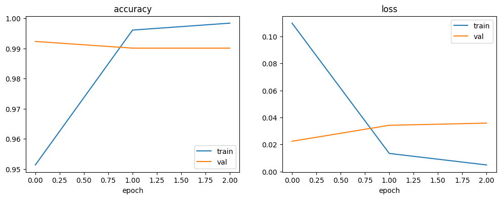
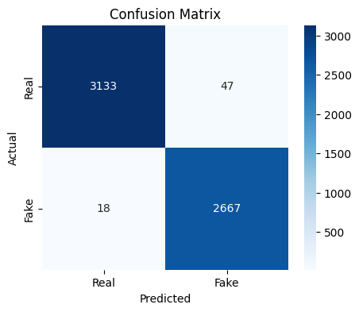

# DL_project
# Fake News Detection using Bidirectional LSTM

Deep learning model (TextVectorization + Embedding + Bidirectional LSTM) that classifies news articles as **real** or **fake**.

**Dataset:** [Fake and Real News Dataset (Kaggle)](https://www.kaggle.com/datasets/clmentbisaillon/fake-and-real-news-dataset)

## Dataset
- 44,898 articles (23,481 fake, 21,417 real)
- After removing empty and duplicate articles: 39,094
- Split: 27,365 train / 5,864 validation / 5,865 test
- The "Reuters" tag is removed during cleaning because it leaks the label

## Results
| Metric | Value |
|---|---|
| Accuracy | 98.89% |
| Precision (Fake) | 98.27% |
| Recall (Fake) | 99.33% |
| F1-score (Fake) | 98.80% |

## Model
- TextVectorization (20,000 words, 300 tokens per article)
- Embedding (64 dimensions) and Bidirectional LSTM (64 units)
- Dropout (0.4), Dense (32, ReLU) and a sigmoid output
- Adam optimizer, binary cross-entropy loss, EarlyStopping on validation loss

## Limitations
- The model learns writing-style patterns and does not fact-check articles.
- This dataset is relatively easy, so results may be lower on news from other sources.

